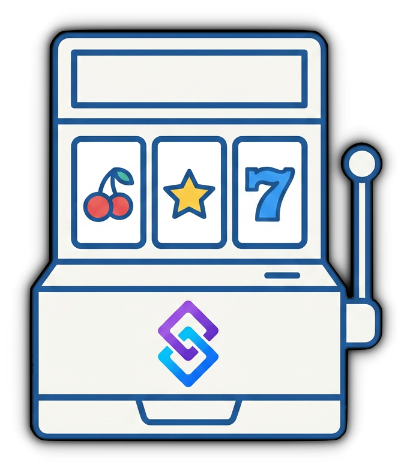

  

<h1 align="center">Slot Machine Game</h1>

  <b>Slots for your chat — on Twitch, YouTube and Kick.</b> 
  Emotes on the reels, rare ones pay more.

  
  
  
  
  
  

  <a href="https://github.com/aaskjer/Slot-Machine-Game/releases"><b>Download</b></a> &nbsp;·&nbsp;
  <a href="Setup-Guide.md"><b>Setup Guide</b></a> &nbsp;·&nbsp;
  <a href="FAQ.md"><b>FAQ</b></a> &nbsp;·&nbsp;
  <a href="Import-String.md"><b>Import String</b></a>

---

## 📖 Overview

Slot Machine Game is a chat game for Streamer.bot. Chat spins with `!slots` and a bet, the reels roll, and
the game settles on the spot: two or more matching slots win, all of them hit the jackpot, anything else
loses the bet.

## ✨ Highlights

- 🎲 **Odds you can see.** Set the match chance, the jackpot chance and the rerolls that control how often
  accidental matches slip through. The settings window shows the odds your settings actually produce and
  plays test spins with the exact chat message.
- 💎 **Rare emotes pay more.** Payouts scale by match tier, from two alike up to the jackpot, and by each
  emote's weight. Three to six reels, an adjustable emote pool, and emotes edited per platform.
- 🎰 **A Jackpot Pool.** Lost bets feed it, and it pays out on top of a jackpot once the bet reaches a minimum.
- 🎫 **Channel Points on Twitch.** A reward can replace the chat command, with four bet modes: cost, typed
  input, fixed or free. YouTube and Kick keep the chat command.
- ⚖️ **Boosts and limits.** Subscriber and VIP boosts on Twitch add up for viewers who are both. Blocked
  groups cannot play, viewers on the Addicted list lose a cut of every win, and Free Mode spins without a
  stake.
- 💬 **Messages that adapt.** Every chat message is editable. Wording inside `{jackpot}…{/jackpot}` only
  reaches chat while the pool is on.
- 🆓 **Free mode from chat.** `!SetFreeSlots` and `!EndFreeSlots` (moderators) switch Free mode, with a message
  to chat and a custom trigger each.
- 🔔 **Hooks for your own actions.** Custom triggers for every win, loss and jackpot with the spin as arguments,
  and per-viewer stats (spins, wins, jackpots, net profit, streaks, …) in Streamer.bot's user variables for a
  leaderboard of your own.
- ⚙️ **One settings window.** Built on [UIFramework for streamer.bot](https://github.com/aaskjer/UIFramework-Streamer.bot)
  and downloaded on first open: light and dark themes, every message with a live preview, and a customise mode
  that lets you rename, reorder and hide pages and fields.

---

## ⚙️ Settings window

The settings action opens a window from [UIFramework for streamer.bot](https://github.com/aaskjer/UIFramework-Streamer.bot),
a separate DLL that is fetched automatically.

- **First open:** a dialog asks whether to download `UIFramework.dll` from the framework's GitHub release into
  `<Streamer.bot>\UIFramework\lib\`. The file is checked against its published SHA-256 before it is used. *No*
  opens that folder so you can put the DLL there yourself; *Cancel* leaves everything as it is.
- **Updates:** when a newer framework release is out, the window asks before it downloads anything. *Cancel* skips
  that version for good.
- **Turning the update check off:** put `"autoUpdate": false` into `uiframework.layout.json`, next to the settings
  file `<Streamer.bot>\Chat Games\Slot Machine Game\SMG-Settings.json` (create it as `{ "autoUpdate": false }` if it is not there yet). The window then
  opens with the DLL it has and asks nothing.
- **Without the window:** the game itself never loads the DLL. Disable the settings action and the game plays on
  with its settings file, which you can still edit by hand.

---

## Credits

- **Author:** [aaskjer on Twitch](https://twitch.tv/aaskjer) · [aaskjer.github.io](https://aaskjer.github.io/)
- **Built for:** [Streamer.bot](https://streamer.bot) by [nate1280](https://www.patreon.com/c/nate1280/home)
- **Works with:** [Currency Core by StreamUP](https://streamup.tips/product/currency-core) · [LOYALTY POINTS by tawmae](https://tawmae.xyz/loyalty-points)
- **Community:** [Slot Machine Game on the Streamer.bot Discord](https://discord.com/channels/834650675224248362/1446889756297527530/1446889756297527530)
- **Thanks:** YOU ♡
