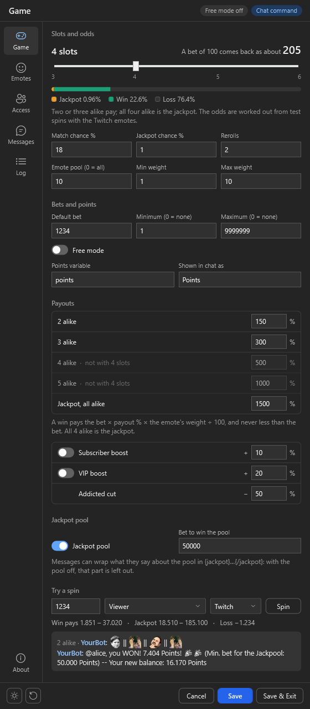
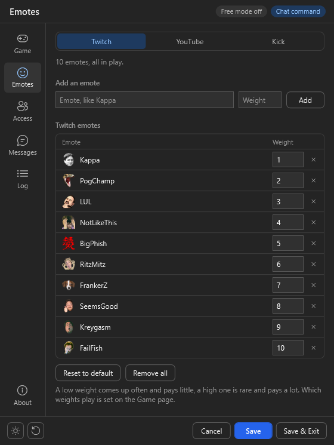
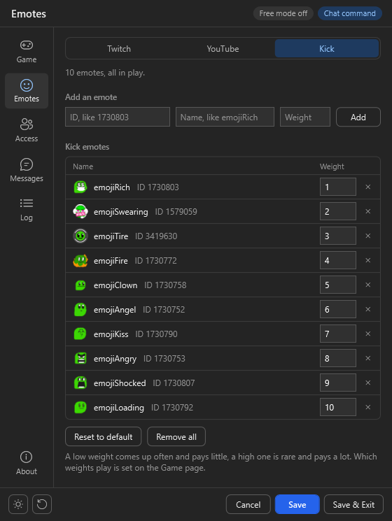
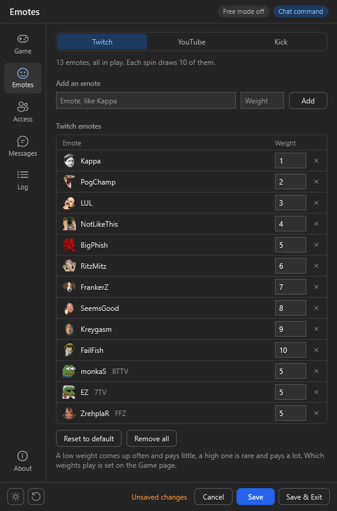
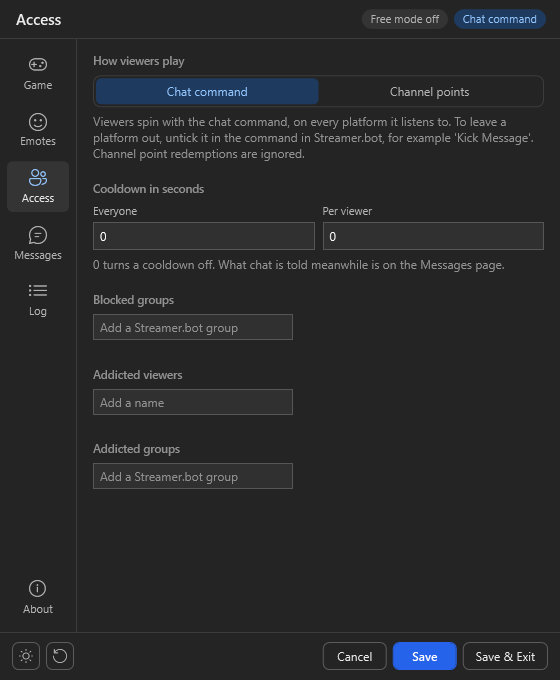
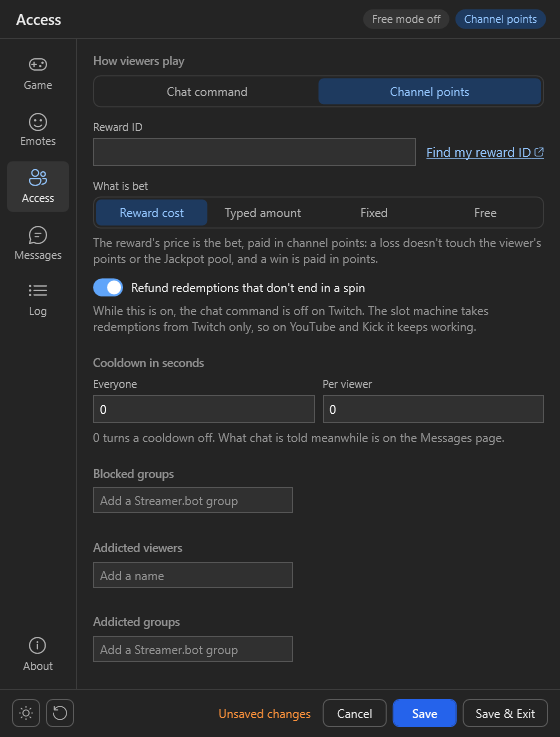
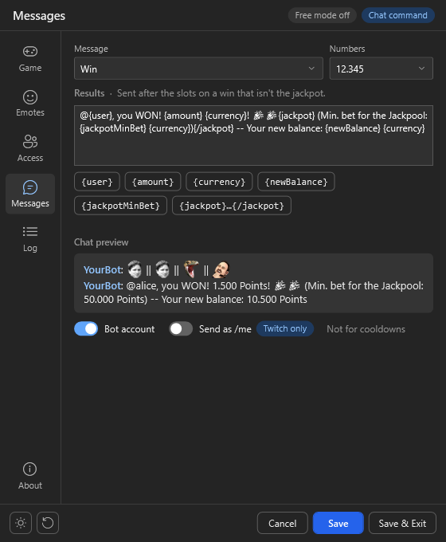
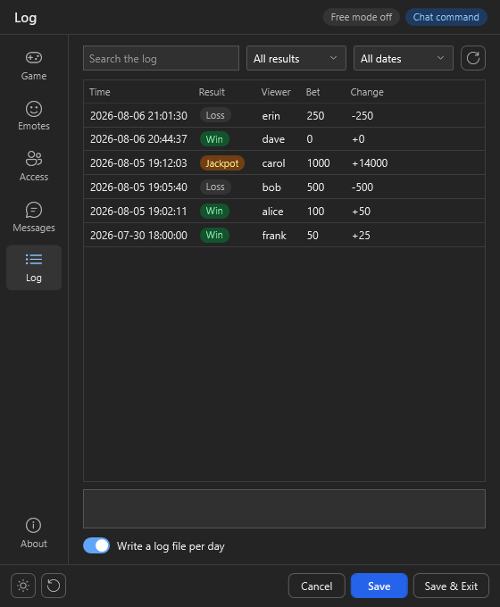
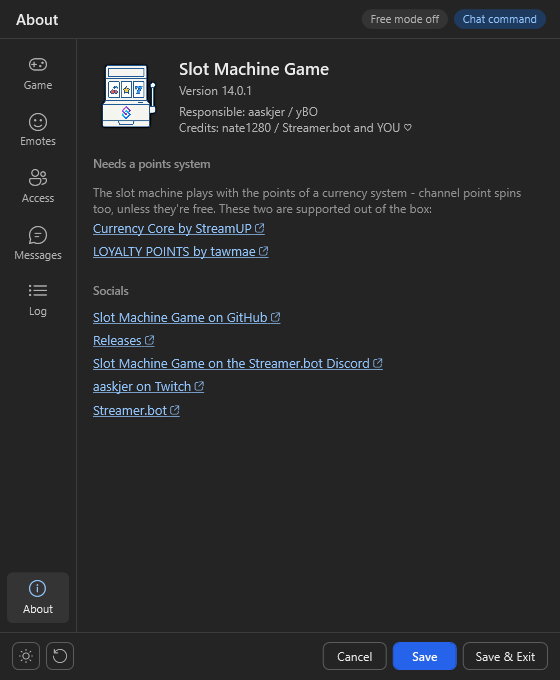

# Import

Click on `Import` in [streamer.bot](https://streamer.bot/) and drag the [SlotMachineGame.sb](https://github.com/aaskjer/Slot-Machine-Game/releases) file into the window, or copy and paste the [import string](https://github.com/aaskjer/Slot-Machine-Game/blob/main/Import-String.md).

Click on `Import` and `Yes` on both following popup messages.

## Enable the command

The command `[SMG] - Play Slots` arrives switched off. In the `Commands` tab, right-click the group `[SMG] Slot Machine Game` and click `Enable All`.

Viewers play with `!slots` or `!spin`, on Twitch, YouTube and Kick alike. To leave a platform out, open the command and untick its source, for example `Kick Message`.

# Setup

In the `Actions` tab, select `[SMG] - Settings`, right-click `Test` in its trigger section and click `Test Trigger` to open the settings window.

Hover over any option for a tooltip with more details. `Save` (or `Ctrl+S`) keeps your changes, `Save & Exit` closes the window afterwards, and `Ctrl+1` to `Ctrl+6` switch between the pages. The buttons at the bottom left switch between dark and light and reset everything to the defaults. When a new version is out, a red `Update` pill shows at the top.

## Game

- **Slots and odds**: how many slots spin (3 to 6), the match and jackpot chances, rerolls, and which emotes play. The bar shows how often a spin really ends in a jackpot, a win or a loss, and how much a bet of 100 brings back on average.
- **Bets and points**: default, minimum and maximum bet, Free mode, and the points variable. Currency Core by StreamUP and LOYALTY POINTS by tawmae are found on their own.
- **Payouts**: what 2, 3, 4 and 5 alike and the jackpot pay, the Subscriber and VIP boosts, and the Addicted cut.
- **Jackpot pool**: lost bets go into the Jackpool, and a jackpot with a big enough bet wins it on top.
- **Try a spin**: pick a bet, who spins and the platform, then click `Spin` to see exactly what chat would get. Nothing is saved, and nobody's points are touched.

## Emotes

Every platform has emotes of its own. Add an emote with a weight: a low weight comes up often and pays little, a high weight is rare and pays a lot. Change a weight right in the list, take an emote out with `×`, or put the defaults back with `Reset to default`.

Kick emotes need their ID and name; hover over the ID field to see where to find it.

Emotes from BTTV, 7TV and FFZ can be added on Twitch too. The window shows them with their picture and where they come from; in chat they show as emotes for viewers who use that extension.

## Access

- **How viewers play**: with the chat command, or on Twitch with a channel point reward.
- **Cooldown in seconds**: for everyone and per viewer. They're written into the command as soon as you save.
- **Blocked groups, addicted viewers and groups**: type a name and press `Enter`; `×` takes it off again. Addicted viewers win less and get messages of their own.

### Twitch Channel Points

1. Pick `Channel points`. The chat command is then off on Twitch, and keeps working on YouTube and Kick.
2. Paste the ID of your reward into `Reward ID`; `Find my reward ID` helps you look it up. Without one, no redemption starts a spin.
3. Pick what is bet: `Reward cost`, `Typed amount`, `Fixed` or `Free`.

Redemptions that don't end in a spin are refunded, as long as the reward doesn't skip the reward requests queue.

WIP - May not work as intended because it was taken from another game and i'm still not an affiliate so i can't properly test it. Please report [here](https://github.com/aaskjer/Slot-Machine-Game/issues) on issues.

## Messages

Edit any message or translate it into your language. Pick a message from the list and click a placeholder to put it in; the chat preview shows the message the way chat will read it. Words about the Jackpool wrapped in `{jackpot}…{/jackpot}` are left out while the jackpot pool is off. `Numbers` sets how chat writes numbers, like 12.345 or 12,345.

Below the preview you pick the sender: your bot account or your own, and `Send as /me`, which exists on Twitch only. The game's messages and the cooldown messages each have their own.

## Log

Every spin, day by day: search for names or amounts, filter by result or date, and click a line to see all of it. `Write a log file per day` switches logging on or off.

## About

Version, links, and the points systems the game supports out of the box.

---

[Frequently Asked Questions](https://github.com/aaskjer/Slot-Machine-Game/blob/main/FAQ.md) · [Report an issue](https://github.com/aaskjer/Slot-Machine-Game/issues)
